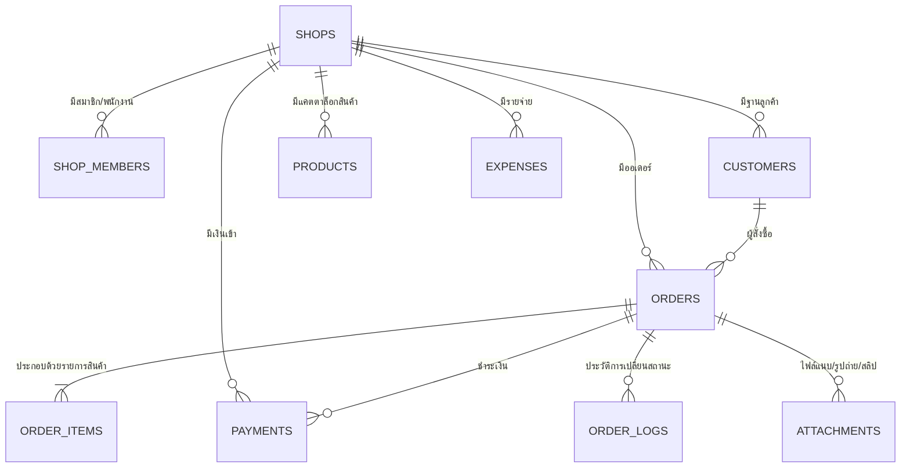

# พจนานุกรมข้อมูล (Database Data Dictionary) & สถาปัตยกรรมฐานข้อมูล
## ระบบบริหารจัดการร้านดอกไม้ (Flower Shop Management System)

เอกสารนี้อธิบายโครงสร้างตาราง, ชนิดข้อมูล (Data Types), ข้อกำหนด (Constraints), ทริกเกอร์ (Triggers), สิทธิ์การเข้าถึง (Row-Level Security - RLS) และการไหลของข้อมูลสำหรับระบบร้านดอกไม้

---

### 1. แผนภาพความสัมพันธ์ของเอนทิตี (Entity-Relationship Overview)

---

### 2. รายละเอียดตารางและฟิลด์ข้อมูล (Data Dictionary)

#### 2.1 ตาราง `shops` (ร้านค้า)
| ฟิลด์ | ชนิดข้อมูล | เงื่อนไข / ค่าเริ่มต้น | คำอธิบาย |
| :--- | :--- | :--- | :--- |
| `id` | UUID | Primary Key, `gen_random_uuid()` | รหัสอ้างอิงร้านค้า |
| `name` | TEXT | NOT NULL | ชื่อร้านดอกไม้ |
| `phone` | TEXT | NULLABLE | เบอร์ติดต่อร้าน |
| `promptpay_number` | TEXT | NULLABLE | เบอร์โทรหรือเลขผู้เสียภาษีพร้อมเพย์สำหรับรับเงิน |
| `address` | TEXT | NULLABLE | ที่ตั้งร้าน |
| `created_at` | TIMESTAMPTZ | DEFAULT `now()` | เวลาที่สร้างร้าน |
| `updated_at` | TIMESTAMPTZ | DEFAULT `now()` | เวลาที่อัปเดตข้อมูลร้านล่าสุด |

---

#### 2.2 ตาราง `shop_members` (สมาชิกและพนักงานในร้าน)
| ฟิลด์ | ชนิดข้อมูล | เงื่อนไข / ค่าเริ่มต้น | คำอธิบาย |
| :--- | :--- | :--- | :--- |
| `id` | UUID | Primary Key, `gen_random_uuid()` | รหัสประจำตัวสมาชิกในร้าน |
| `shop_id` | UUID | Foreign Key (`shops.id`) ON DELETE CASCADE | ร้านที่สังกัด |
| `user_id` | UUID | Foreign Key (`auth.users.id`) ON DELETE CASCADE | รหัสผู้ใช้ระบบ Auth ของ Supabase |
| `role` | TEXT | NOT NULL, CHECK in (`'owner'`, `'staff'`) | บทบาท (`owner` = เจ้าของ, `staff` = พนักงาน) |
| `display_name` | TEXT | NOT NULL | ชื่อที่แสดงในระบบ (เช่น นิว, แนน, ช่างดอกไม้เอก) |
| `is_active` | BOOLEAN | NOT NULL, DEFAULT `true` | เปิด/ปิดการใช้งาน (ถ้า `false` จะถูกตัดสิทธิ์ทันที) |
| `created_at` | TIMESTAMPTZ | DEFAULT `now()` | เวลาที่เพิ่มผู้ใช้ |
| `updated_at` | TIMESTAMPTZ | DEFAULT `now()` | เวลาที่อัปเดตข้อมูลล่าสุด |
*Unique Constraint*: `(shop_id, user_id)`

---

#### 2.3 ตาราง `customers` (ลูกค้า)
| ฟิลด์ | ชนิดข้อมูล | เงื่อนไข / ค่าเริ่มต้น | คำอธิบาย |
| :--- | :--- | :--- | :--- |
| `id` | UUID | Primary Key, `gen_random_uuid()` | รหัสลูกค้า |
| `shop_id` | UUID | Foreign Key (`shops.id`) ON DELETE CASCADE | ร้านค้าที่เป็นเจ้าของข้อมูล |
| `name` | TEXT | NOT NULL | ชื่อลูกค้า |
| `phone` | TEXT | NULLABLE, Indexed | เบอร์โทรศัพท์ (ใช้ค้นหาด่วนตอนสั่งซื้อ) |
| `note` | TEXT | NULLABLE | ข้อมูลเพิ่มเติม เช่น โทนสีที่ชอบ, วันเกิด |
| `created_at` | TIMESTAMPTZ | DEFAULT `now()` | วันที่บันทึกข้อมูล |
| `updated_at` | TIMESTAMPTZ | DEFAULT `now()` | วันที่แก้ไขล่าสุด |

---

#### 2.4 ตาราง `products` (แคตตาล็อกสินค้าและดอกไม้)
| ฟิลด์ | ชนิดข้อมูล | เงื่อนไข / ค่าเริ่มต้น | คำอธิบาย |
| :--- | :--- | :--- | :--- |
| `id` | UUID | Primary Key, `gen_random_uuid()` | รหัสสินค้า |
| `shop_id` | UUID | Foreign Key (`shops.id`) ON DELETE CASCADE | ร้านค้าที่เป็นเจ้าของสินค้า |
| `name` | TEXT | NOT NULL | ชื่อสินค้า/ดอกไม้ |
| `type` | TEXT | CHECK in (`'bouquet'`, `'fresh_flower'`, `'custom'`, `'accessory'`) | หมวดหมู่สินค้า |
| `size` | TEXT | NULLABLE | ขนาด (เช่น S, M, L, XL, Standard) |
| `unit` | TEXT | NOT NULL, DEFAULT `'ช่อ'` | หน่วยนับ (ช่อ, ดอก, ก้าน, กำ, แจกัน, กล่อง) |
| `price` | NUMERIC(12,2) | NOT NULL, CHECK `>= 0` | ราคาขายหน้าร้านปกติ |
| `image_url` | TEXT | NULLABLE | ลิงก์รูปตัวอย่างสินค้า |
| `is_active` | BOOLEAN | NOT NULL, DEFAULT `true` | สถานะเปิดขาย (`true`) หรือซ่อนชั่วคราว (`false`) |
| `created_at` | TIMESTAMPTZ | DEFAULT `now()` | เวลาที่เพิ่มสินค้า |
| `updated_at` | TIMESTAMPTZ | DEFAULT `now()` | เวลาที่แก้ไขล่าสุด |

---

#### 2.5 ตาราง `orders` (ออเดอร์สั่งซื้อ)
| ฟิลด์ | ชนิดข้อมูล | เงื่อนไข / ค่าเริ่มต้น | คำอธิบาย |
| :--- | :--- | :--- | :--- |
| `id` | UUID | Primary Key, `gen_random_uuid()` | รหัสออเดอร์ภายในระบบ |
| `shop_id` | UUID | Foreign Key (`shops.id`) ON DELETE CASCADE | รหัสร้านค้า |
| `order_no` | TEXT | NOT NULL, Unique ต่อร้าน | เลขที่บิลอ่านง่าย รูปแบบ `YYMMDD-XXX` (เช่น `261015-001`) |
| `customer_id` | UUID | Foreign Key (`customers.id`) ON DELETE SET NULL | ลูกค้าผู้สั่ง |
| `channel` | TEXT | CHECK in (`'walk_in'`, `'line'`, `'facebook'`, `'instagram'`, `'phone'`, `'other'`) | ช่องทางการรับออเดอร์ |
| `order_type` | TEXT | CHECK in (`'walk_in'`, `'chat'`) | ประเภทการสั่ง (`walk_in` หน้าร้าน, `chat` ออนไลน์) |
| `fulfillment_type` | TEXT | CHECK in (`'pickup'`, `'delivery'`) | การส่งมอบ (`pickup` รับเอง, `delivery` จัดส่ง) |
| `fulfillment_status` | TEXT | CHECK in (`'new'`, `'arranging'`, `'ready'`, `'done'`, `'cancelled'`), DEFAULT `'new'` | สถานะการจัดทำ/จัดส่ง |
| `payment_status` | TEXT | CHECK in (`'unpaid'`, `'partial'`, `'paid'`), DEFAULT `'unpaid'` | สถานะการชำระเงิน (คำนวณอัตโนมัติจากทริกเกอร์) |
| `subtotal` | NUMERIC(12,2) | NOT NULL, DEFAULT 0, CHECK `>= 0` | ราคารวมสินค้าก่อนหักส่วนลด |
| `discount` | NUMERIC(12,2) | NOT NULL, DEFAULT 0, CHECK `>= 0` | ส่วนลด |
| `delivery_fee` | NUMERIC(12,2) | NOT NULL, DEFAULT 0, CHECK `>= 0` | ค่าจัดส่ง |
| `total` | NUMERIC(12,2) | NOT NULL, DEFAULT 0, CHECK `>= 0` | ยอดสุทธิที่ต้องชำระ `(subtotal - discount) + delivery_fee` |
| `due_at` | TIMESTAMPTZ | NOT NULL, Indexed | เวลานัดรับหรือกำหนดส่งมอบ |
| `recipient_name` | TEXT | NULLABLE | ชื่อผู้รับ |
| `recipient_phone` | TEXT | NULLABLE | เบอร์ติดต่อผู้รับ |
| `address` | TEXT | NULLABLE | ที่อยู่จัดส่ง |
| `card_message` | TEXT | NULLABLE | ข้อความในการ์ดอวยพร |
| `note` | TEXT | NULLABLE | โน้ตพิเศษ เช่น โทนสี ริบบิ้น ดอกไม้ที่ต้องระวัง |
| `created_by` | UUID | Foreign Key (`auth.users.id`) | พนักงานผู้เปิดบิล |
| `arranged_by` | UUID | Foreign Key (`auth.users.id`) | ช่างผู้จัดดอกไม้ |
| `delivered_by` | UUID | Foreign Key (`auth.users.id`) | ผู้ส่งหรือผู้ส่งมอบ |
| `created_at` | TIMESTAMPTZ | DEFAULT `now()` | เวลาที่สร้างออเดอร์ |
| `updated_at` | TIMESTAMPTZ | DEFAULT `now()` | เวลาที่อัปเดตล่าสุด |

---

#### 2.6 ตาราง `order_items` (รายการสินค้าในออเดอร์)
| ฟิลด์ | ชนิดข้อมูล | เงื่อนไข / ค่าเริ่มต้น | คำอธิบาย |
| :--- | :--- | :--- | :--- |
| `id` | UUID | Primary Key, `gen_random_uuid()` | รหัสรายการ |
| `order_id` | UUID | Foreign Key (`orders.id`) ON DELETE CASCADE | ออเดอร์ที่สังกัด |
| `product_id` | UUID | Foreign Key (`products.id`) ON DELETE SET NULL | สินค้าต้นแบบ (ถ้ามี) |
| `name_snapshot` | TEXT | NOT NULL | **ชื่อสินค้า ณ ขณะสั่งซื้อ** (ไม่เปลี่ยนแม้ราคา/ชื่อในแคตตาล็อกเปลี่ยน) |
| `qty` | INTEGER | NOT NULL, DEFAULT 1, CHECK `> 0` | จำนวน |
| `unit_price` | NUMERIC(12,2) | NOT NULL, CHECK `>= 0` | ราคาต่อหน่วย ณ ขณะสั่งซื้อ |
| `total_price` | NUMERIC(12,2) | GENERATED ALWAYS AS `(qty * unit_price)` STORED | ราคารวมรายการ |
| `note` | TEXT | NULLABLE | รายละเอียดปรับแต่งของชิ้นนี้ |
| `created_at` | TIMESTAMPTZ | DEFAULT `now()` | เวลาที่บันทึก |

---

#### 2.7 ตาราง `payments` (เงินเข้า / การชำระเงิน)
| ฟิลด์ | ชนิดข้อมูล | เงื่อนไข / ค่าเริ่มต้น | คำอธิบาย |
| :--- | :--- | :--- | :--- |
| `id` | UUID | Primary Key, `gen_random_uuid()` | รหัสการชำระ |
| `shop_id` | UUID | Foreign Key (`shops.id`) ON DELETE CASCADE | รหัสร้านค้า |
| `order_id` | UUID | Foreign Key (`orders.id`) ON DELETE CASCADE | ออเดอร์ที่รับชำระ |
| `amount` | NUMERIC(12,2) | NOT NULL, CHECK `> 0` | จำนวนเงินที่รับเข้าจริง (รองรับมัดจำ/แบ่งจ่ายหลายงวด) |
| `method` | TEXT | CHECK in (`'cash'`, `'promptpay'`, `'transfer'`, `'card'`, `'other'`) | ช่องทางการรับเงิน |
| `paid_at` | TIMESTAMPTZ | DEFAULT `now()` | เวลาที่เงินเข้า |
| `received_by` | UUID | Foreign Key (`auth.users.id`) | พนักงานผู้รับเงิน |
| `slip_url` | TEXT | NULLABLE | รูปภาพหลักฐานการโอน / สลิป |
| `note` | TEXT | NULLABLE | โน้ต เช่น เงินทอน, เลขอ้างอิงสลิป |
| `created_at` | TIMESTAMPTZ | DEFAULT `now()` | เวลาที่บันทึกเข้าระบบ |

---

#### 2.8 ตาราง `expenses` (รายจ่ายของร้าน - เจ้าของร้านเท่านั้นที่เข้าถึงได้)
| ฟิลด์ | ชนิดข้อมูล | เงื่อนไข / ค่าเริ่มต้น | คำอธิบาย |
| :--- | :--- | :--- | :--- |
| `id` | UUID | Primary Key, `gen_random_uuid()` | รหัสรายการจ่าย |
| `shop_id` | UUID | Foreign Key (`shops.id`) ON DELETE CASCADE | รหัสร้านค้า |
| `category` | TEXT | CHECK in (`'flower_stock'`, `'accessories'`, `'packaging'`, `'transportation'`, `'utilities'`, `'wage'`, `'other'`) | หมวดหมู่รายจ่าย |
| `amount` | NUMERIC(12,2) | NOT NULL, CHECK `> 0` | จำนวนเงินที่จ่าย |
| `method` | TEXT | CHECK in (`'cash'`, `'promptpay'`, `'transfer'`, `'card'`, `'other'`) | ช่องทางที่จ่ายออก |
| `spent_at` | TIMESTAMPTZ | DEFAULT `now()` | วันที่และเวลาที่จ่ายเงิน |
| `note` | TEXT | NULLABLE | รายละเอียด (เช่น ซื้อดอกไม้ปากคลองรอบเช้า) |
| `receipt_url` | TEXT | NULLABLE | รูปถ่ายใบเสร็จ / บิลเงินสด |
| `created_by` | UUID | Foreign Key (`auth.users.id`) | ผู้บันทึกรายการ |
| `created_at` | TIMESTAMPTZ | DEFAULT `now()` | เวลาที่บันทึก |
| `updated_at` | TIMESTAMPTZ | DEFAULT `now()` | เวลาที่แก้ไข |

---

#### 2.9 ตาราง `order_logs` (ประวัติการแก้ไขและเปลี่ยนสถานะ)
| ฟิลด์ | ชนิดข้อมูล | เงื่อนไข / ค่าเริ่มต้น | คำอธิบาย |
| :--- | :--- | :--- | :--- |
| `id` | UUID | Primary Key, `gen_random_uuid()` | รหัสบันทึก |
| `order_id` | UUID | Foreign Key (`orders.id`) ON DELETE CASCADE | ออเดอร์ที่เกี่ยวข้อง |
| `actor_id` | UUID | Foreign Key (`auth.users.id`) | พนักงานที่กระทำการ |
| `action` | TEXT | NOT NULL | การกระทำ เช่น `fulfillment_status`, `payment_status`, `payment_added` |
| `from_value` | TEXT | NULLABLE | สถานะเดิม |
| `to_value` | TEXT | NULLABLE | สถานะใหม่ |
| `note` | TEXT | NULLABLE | คำอธิบายเพิ่มเติม |
| `created_at` | TIMESTAMPTZ | DEFAULT `now()` | เวลาที่เกิดเหตุการณ์ |

---

#### 2.10 ตาราง `attachments` (รูปภาพและไฟล์แนบ)
| ฟิลด์ | ชนิดข้อมูล | เงื่อนไข / ค่าเริ่มต้น | คำอธิบาย |
| :--- | :--- | :--- | :--- |
| `id` | UUID | Primary Key, `gen_random_uuid()` | รหัสไฟล์แนบ |
| `shop_id` | UUID | Foreign Key (`shops.id`) ON DELETE CASCADE | รหัสร้านค้า |
| `order_id` | UUID | Foreign Key (`orders.id`) ON DELETE CASCADE | ออเดอร์ที่แนบไฟล์ |
| `kind` | TEXT | CHECK in (`'bouquet_preview'`, `'slip'`, `'chat_screenshot'`, `'receipt'`, `'delivery_proof'`) | ประเภทไฟล์ |
| `url` | TEXT | NOT NULL | ที่อยู่ URL ใน Supabase Storage |
| `created_by` | UUID | Foreign Key (`auth.users.id`) | ผู้บันทึก/อัปโหลด |
| `created_at` | TIMESTAMPTZ | DEFAULT `now()` | เวลาที่อัปโหลด |

---

### 3. ตารางสิทธิ์การเข้าถึงข้อมูล (Row-Level Security Matrix)

ตามข้อตกลงความปลอดภัย: **เจ้าของร้าน (Owner) มีสิทธิ์เห็นข้อมูลการเงินและรายจ่ายทั้งหมด ส่วนพนักงาน (Staff) จะเห็นเฉพาะข้อมูลที่จำเป็นต่อการปฏิบัติงานหน้าร้านเท่านั้น**

| ตาราง | สิทธิ์พนักงาน (Staff) | สิทธิ์เจ้าของร้าน (Owner) | หมายเหตุ / นโยบายความปลอดภัย |
| :--- | :--- | :--- | :--- |
| **`shops`** | SELECT (ร้านตนเอง) | SELECT, UPDATE | พนักงานแก้ไขข้อมูลร้านไม่ได้ |
| **`shop_members`** | SELECT (เพื่อนร่วมงาน) | SELECT, INSERT, UPDATE, DELETE | เฉพาะเจ้าของร้านที่เพิ่ม/ระงับสิทธิ์พนักงานได้ |
| **`customers`** | SELECT, INSERT, UPDATE | ALL (รวม DELETE) | พนักงานค้นหาและบันทึกลูกค้าได้ แต่ลบไม่ได้ |
| **`products`** | SELECT (เฉพาะ `is_active`) | ALL | พนักงานดูราคาขายเพื่อคิดเงิน แต่แก้ราคาไม่ได้ |
| **`orders`** | SELECT, INSERT, UPDATE | ALL | พนักงานเปิดบิลและอัปเดตสถานะจัดทำได้ ลบไม่ได้ |
| **`order_items`** | SELECT, INSERT, UPDATE | ALL | ป้องกันการแก้ไขย้อนหลังเมื่อบิลปิดแล้ว |
| **`payments`** | SELECT, INSERT | ALL (รวม UPDATE/DELETE) | **พนักงานบันทึกเงินเข้าได้ แต่แก้ไข/ลบไม่ได้** ป้องกันทุจริต |
| **`expenses`** | **NO ACCESS (ไม่มีสิทธิ์)** | ALL | **ห้ามพนักงานเข้าถึงตารางรายจ่ายโดยเด็ดขาด** |
| **`order_logs`** | SELECT, INSERT | ALL | ตรวจสอบย้อนหลังได้ว่าใครเปลี่ยนสถานะเมื่อใด |
| **`attachments`**| SELECT, INSERT | ALL | อัปโหลดรูปช่อก่อนส่ง และสลิปโอนเงิน |

---

### 4. ทริกเกอร์และระบบอัตโนมัติ (Automation & Triggers)

#### 4.1 การคำนวณสถานะการชำระเงินอัตโนมัติ (`trg_sync_payment_status`)
เมื่อมีรายการในตาราง `payments` ถูกเพิ่ม แก้ไข หรือลบ:
1. ระบบจะหาผลรวม `SUM(amount)` สำหรับออเดอร์นั้น
2. นำไปเปรียบเทียบกับ `orders.total`:
   - ถ้า `SUM(amount) == 0` $\rightarrow$ `payment_status = 'unpaid'`
   - ถ้า `0 < SUM(amount) < total` $\rightarrow$ `payment_status = 'partial'` (มัดจำแล้ว)
   - ถ้า `SUM(amount) >= total` $\rightarrow$ `payment_status = 'paid'` (ชำระครบถ้วน)
3. อัปเดต `orders.payment_status` อัตโนมัติ โดยไม่ต้องเขียนโค้ดคำนวณซ้ำซ้อนใน Frontend

#### 4.2 การบันทึกประวัติสถานะอัตโนมัติ (`trg_log_order_changes`)
เมื่อมีการอัปเดตตาราง `orders`:
- ถ้า `fulfillment_status` มีการเปลี่ยนค่า $\rightarrow$ บันทึกเข้า `order_logs` ทันที พร้อมระบุ `actor_id` (ผู้ทำรายการ), `from_value`, `to_value`
- ถ้า `payment_status` มีการเปลี่ยนค่า $\rightarrow$ บันทึกเข้า `order_logs` ทันที

#### 4.3 ลำดับเลขที่ออเดอร์รายวัน (`fn_get_next_order_no`)
- รูปแบบ: `YYMMDD-XXX` เช่น `261015-001`
- มีตาราง `order_number_seq` จัดการ Sequence รายวันและแยกตามร้านค้า ไม่เกิดเลขซ้ำแม้เปิดบิลพร้อมกัน
